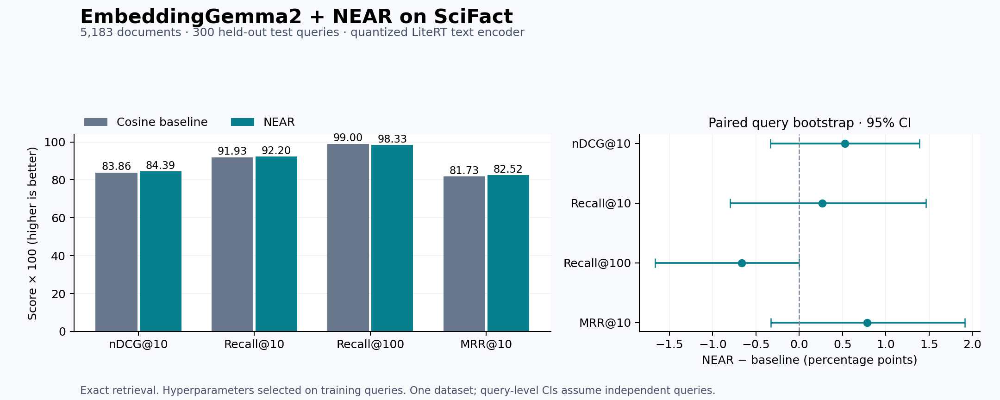

# Measured result: EmbeddingGemma2 + NEAR on SciFact

NEAR **improved nDCG@10**; change: **+0.53 percentage points** (+0.63% relative). The paired 95% bootstrap interval for the change is [-0.33, +1.39] points. The interval includes zero, so this run does not establish a reliable improvement.

These are locally measured held-out results, not numbers copied from the paper.

| Metric | Baseline | NEAR | Change (points) | 95% CI for change |
|---|---:|---:|---:|---:|
| nDCG@10 | 83.86 | 84.39 | +0.53 | [-0.33, +1.39] |
| Recall@10 | 91.93 | 92.20 | +0.27 | [-0.80, +1.47] |
| Recall@100 | 99.00 | 98.33 | -0.67 | [-1.67, +0.00] |
| MRR@10 | 81.73 | 82.52 | +0.79 | [-0.33, +1.91] |

Scores above are multiplied by 100. Recall is standard uncapped recall; capped Recall@10 is also in results.json.

## Protocol

- Corpus: all **5,183** SciFact documents; **807** official training queries for selection; **300** official test queries.
- Cross-split exact-text duplicates removed only from development: ['1291', '871']. Test queries unchanged. See split_audit.json.
- Encoder: EmbeddingGemma2, text path of the 440M text/vision LiteRT package; 270M text backbone, INT4 QAT weights, 768-dimensional output. No images are used.
- Identical cached embeddings for both methods; no encoder training. Query prefix: `task: search result | query: `; document format: `title: {title} | text: {text}`.
- Up to 8,192 input tokens, automatic signature selection, overflow errors rather than silent truncation. All input items completed successfully.
- NEAR: k=50, at most 16 anchors, 4 routed anchors, beta=10, seed=42. All 30 paper configurations tried only on development queries.
- Selected: L=1, normalized residuals=True, alpha=0.25. Selection saved before test evaluation.
- Exact inner-product retrieval over the complete corpus. This isolates NEAR scoring from approximate-search errors.
- Test nDCG@10 improved on 16 queries, worsened on 20, and was unchanged on 264.

## Cost and validation

- NEAR corpus preprocessing for all 3 candidate layers, reused by the development grid: 7.14 seconds.
- Vector index: 768 → 1536 dimensions; 15.18 → 30.37 MiB for float32 keys.
- Query reference tables: 96.0 KiB.
- Storage numbers describe the selected float32 search keys and routing tables, excluding research caches and any ANN graph overhead.
- Median CPU transform + exact retrieval: baseline 0.39 ms; NEAR 1.02 ms. Encoder time excluded; these are local microbenchmarks.
- Concatenated score versus explicit equation: max absolute difference 2.86e-05.
- Independent metric verification: all per-query nDCG@10 and Recall@10/100 match.

## Limits

- Single standard dataset, not the paper's eight-task LMEB reproduction.
- Quantized LiteRT EmbeddingGemma2 text path; not the full-precision checkpoint.
- Query holdout with a shared corpus, not candidate-bank holdout.
- Bootstrap resamples queries with fixed selected hyperparameters; related claims may be dependent.
- Exact search separates scoring quality from ANN approximation; HNSW results require --hnsw.
- The paper leaves clustering initialization/stopping unspecified. This implementation uses seeded spherical k-means++, three restarts, and at most 100 iterations.
- Pretrained model exposure to this standard benchmark is unknown; this is a same-encoder comparison, not a claim of uncontaminated pretraining.

## Inspect and reproduce

See [the project README](../../README.md) for exact commands. Inspect [selection.json](selection.json), [dev_grid.json](dev_grid.json), [results.json](results.json), [per_query.json](per_query.json), and [examples.json](examples.json). TREC run files retain the top 100 results for every test query.

Sources: [NEAR paper](https://arxiv.org/html/2610.13314v1), [EmbeddingGemma2](https://huggingface.co/google/embeddinggemma-2), [LiteRT checkpoint](https://huggingface.co/litert-community/embeddinggemma-2-text-vision-440m-litert-lm), [SciFact mirror](https://huggingface.co/datasets/mteb/scifact).

## Development result

The best positive-weight NEAR candidate scored 98.54 nDCG@10 on development, versus 98.67 for the baseline. The published 30-setting grid contains only positive residual weights. The baseline would win a development-only choice between the two methods. The development baseline is nearly saturated; this limits how informative that split is for selecting a correction.

## Queries that changed most

These examples are selected after evaluation for explanation, not parameter tuning. A missing rank means the judged document was outside the top 100.

### Largest gains

**Query 800:** Modifying the epigenome in the brain affects the normal human aging process by affecting certain genes related to neurogenesis.

nDCG@10 change: +36.91 points.

- Relevant document 22543403: rank **2 → 1**. Epigenetic mechanisms in neurological disease

**Query 700:** Localization of PIN1 in the Arabidopsis embryo does not require VPS9a

nDCG@10 change: +36.91 points.

- Relevant document 4350400: rank **2 → 1**. Generation of cell polarity in plants links endocytosis, auxin distribution and cell fate decisions

### Largest losses

**Query 185:** Breast cancer development is determined exclusively by genetic factors.

nDCG@10 change: -56.93 points.

- Relevant document 18340282: rank **1 → 4**. Gene–environment interactions in 7610 women with breast cancer: prospective evidence from the Million Women Study

**Query 535:** Hypertension is frequently observed in type 1 diabetes patients.

nDCG@10 change: -33.33 points.

- Relevant document 39368721: rank **7 → 16**. Glucose tolerance and blood pressure: long term follow up in middle aged men.
